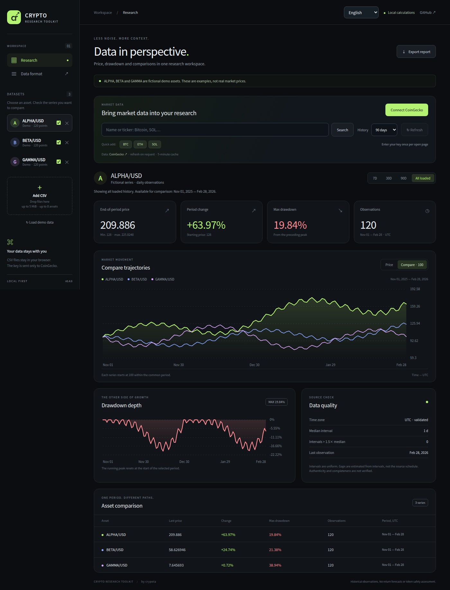

# Crypto Research Toolkit

A local-first browser dashboard with CoinGecko integration and a Python CLI.
Compare trajectories, inspect drawdowns, check sampling quality and export a
research report. Use a CoinGecko Demo API key for online history, or work offline
with CSV files. No wallet connection, CDN or backend is required.

The included ALPHA, BETA, GAMMA and SAMPLE data is **fictional**, not live market data.



## Open the dashboard

1. Download this repository with **Code → Download ZIP**, then extract it.
2. Open **`dist/crypto-research-toolkit.html`** in a modern browser. This one file
   includes everything it needs and can be moved or shared independently.
3. Click **Подключить CoinGecko**, paste your Demo API key, and choose
   **Подключить и загрузить** to fetch Bitcoin, Ethereum and Solana.
4. Search by name/ticker to add other CoinGecko-listed coins, or work with CSV/demo data.

Alternatively, open `index.html` from the extracted repository, keeping the
`assets` directory beside it. The interface supports English, Korean, Japanese, German, Russian and Spanish.

### Languages

Use the language menu at the top right: **English · 한국어 · 日本語 · Deutsch · Русский · Español**.
The initial language follows your supported browser preference, with English as
the fallback. An explicit selection is remembered for this page when browser
storage is available. Only the language code (`crt.language`) is stored: never
API keys, loaded prices or CSV contents.

Switching languages does not reload the page, change selected assets/periods,
clear a connection or make API requests. UI labels, dialogs, accessibility labels,
validation/API errors, existing messages/search results and chart tooltips update.
Dates and numbers follow the locale; all observation times remain UTC.

Markdown and SVG reports and human-readable JSON notes use the selected language.
JSON adds a `language` code. Machine-readable JSON/CSV field names, decimal-point
numbers, booleans, ticker symbols, CoinGecko IDs and ISO timestamps stay stable.
The Python CLI remains a separate command-line tool.

Translations are bundled in `assets/i18n.js`; there is no translation API, CDN,
external font download or per-language network request. The app uses installed
system fonts for Korean and Japanese. Russian source strings are stable
gettext-style message IDs; keep all five translated values and named placeholders
when updating a message.

### CoinGecko connection

The default workspace starts empty and offers real market history. Demo series
are loaded only when you explicitly click the demo button.

- Get a free Demo key from the [CoinGecko Developer Dashboard](https://www.coingecko.com/en/developers/dashboard).
- Enter it in the password field inside the app. The field is cleared after connection.
- The key lives only inside the API client in page memory: never in HTML/source,
  URLs, localStorage, sessionStorage or exports (only the language preference is saved). The app has no server-side key store. Reload/close the
  page or disconnect to clear the client. Disconnect retains already loaded prices.
- Authenticated requests go directly to `https://api.coingecko.com`, using the
  `x-cg-demo-api-key` header. CoinGecko receives the key, coin IDs/search terms
  and your network request information. CSV file contents stay local.
- The app fetches history on connect and on user actions. It does not poll in the
  background. The first BTC/ETH/SOL load uses three history requests.
- Successful responses are cached in memory for five minutes for repeated loads.
  **Обновить** always makes new API requests and preserves the selected chart filter;
  it does not bypass provider rate limits. CoinGecko can still serve delayed prices.
- Choose 7/30/90/365 days in **История** to fetch a different lookback. The chart's
  separate 7/30/90/**Вся загрузка** buttons filter already loaded observations
  without API calls. All loaded history is not the coin's lifetime history. The
  visible period explanation shows the available date range; changing the API
  lookback resets the chart filter to all loaded history.
- Search shows exact CoinGecko IDs to distinguish similarly named assets. It
  covers CoinGecko's coin search, not arbitrary onchain contracts or DEX pools.
- During loading, CSV import and asset changes are locked to prevent conflicting
  updates. **Отменить загрузку** aborts the request, clears the key, and retains
  observations already received. Reconnect before making new requests.
- Each online asset shows its requested lookback and fetch time. Partial failures
  explicitly report which histories were retained.
- Bad keys, plan/network errors and rate limits are explained. Failed refreshes
  keep previously loaded data; they never silently substitute synthetic prices.

Each online dataset records its CoinGecko ID, credential-free source URL,
fetch time and excluded malformed/duplicate rows. JSON and Markdown reports
include provenance, not credentials. API history is sampled and can be delayed;
it is not a streaming trading feed. Demo history is limited by the provider's plan.

If direct browser access fails because of network/CORS restrictions, the app
shows an error and CSV/demo remain usable; it does not forward your key through
an untrusted public proxy.

API references: [history](https://docs.coingecko.com/demo/reference/coins-id-market-chart),
[coin search](https://docs.coingecko.com/demo/reference/search-data),
[errors/rate limits](https://docs.coingecko.com/docs/errors-and-rate-limits).
Market data attribution: [CoinGecko](https://www.coingecko.com/en/api).

### Features

- Import or drag-and-drop up to eight CSV files, one asset/quote pair per file.
- Choose an active asset; check other series to include them in comparison.
- Switch between actual price and comparison normalized to 100.
- Select 7, 30, 90 days or all history, relative to the last observation.
- Inspect charts with the pointer or keyboard: focus a chart, use arrow keys,
  Home/End, or Escape to dismiss the tooltip.
- Read change, maximum sampled drawdown, extrema and observation counts.
- Inspect sampling intervals, unusually long intervals and the last file observation.
- Export Markdown/JSON reports, combined observations as CSV, or a chart as SVG.

Imported files, API responses and credentials stay in browser memory.
Closing/reloading the page clears them. Loading a
new file never modifies the original on disk. Demo loading adds three series.

### Comparison rules and limitations

Comparison uses the **intersection of selected time ranges**. Each series needs
at least two observations inside that window. Insufficient overlap is shown
explicitly. Each series' first recorded price in the window becomes 100; those
first observation timestamps need not be identical. Tooltips identify the actual
nearest observation time for each series. Missing records are not resampled or
invented. Lines connect recorded points as a visual guide.

Drawdown resets at the beginning of the selected period. The quality panel
checks that period, while its last-observation date uses the entire dataset.
An interval over 1.5 times the median is a **heuristic**, not proof of a missing
record. Even uniform intervals do not establish authenticity or completeness.

CSV export is a combined five-column analysis table
(`timestamp,symbol,series,price,synthetic`), not the three-column import format.
Filter one series and retain `timestamp,symbol,price` to import it again.
JSON/Markdown include source filenames and input SHA-256 hashes when Web Crypto
is available. Demo series have no original-file hash.

The dashboard uses JavaScript floating-point numbers; use the Python CLI for
decimal arithmetic. Browser timestamps must use ISO 8601 with a timezone and at
most three fractional-second digits. Limits: 5 MiB and 100,000 observations per
file, up to eight series. Large charts preserve bucket extrema while reducing
rendered points; statistics use all observations.

## Development and checks

Plain HTML/CSS/JavaScript, without frontend dependencies. From the repo root:

```sh
python tools/build_standalone.py
node --test tests/analytics.test.cjs tests/coingecko.test.cjs tests/i18n.test.cjs
python -m unittest discover -s tests -v
```

The six-language suite additionally checks live switching, localized messages,
number/date formatting, stable export contracts, language-only persistence and
24 language/viewport combinations (320, 390, 768 and 1400 px). API fixtures are
explicitly synthetic.

The first command regenerates `dist/crypto-research-toolkit.html` from source.
Commit source and bundle together. Node 18+ is needed only for developer tests.

Optional browser checks require Playwright with Chromium installed:

```sh
npm install --no-save playwright
npx playwright install chromium
node tests/dashboard-browser.cjs
node tests/coingecko-browser.cjs
node tests/audit-browser.cjs
node tests/i18n-browser.cjs
```

The offline browser suite checks CSV import, invalid data, periods, chart controls,
exports, mobile and standalone operation without external network requests.
The behavioral audit additionally checks every period button, fresh refreshes,
all exports, mobile/tablet dialogs, capacity, cancellation, concurrent-import
guards and standalone file operation. See [audit findings](docs/audit-2026-10-20.md).
The CoinGecko browser suite intercepts requests with explicitly synthetic test
fixtures to check key isolation, cache, search, provenance, API errors and disconnect. Screenshots are saved in `docs/`.

An optional real-data smoke test is available as `tests/coingecko-live.cjs`.
It reads `COINGECKO_DEMO_API_KEY` from the process environment without printing it.
For restricted test environments, `COINGECKO_TEST_HTTPS_TRANSPORT=python` delegates
HTTPS in the test harness to Python's certificate-validating urllib; the app
itself still calls CoinGecko directly. This test-only mode is not a production proxy.


## Python CLI

Python 3.10 or newer. Run from the repository root:

```sh
python crypto_report.py examples/sample_prices.csv
python crypto_report.py examples/sample_prices.csv --format json
python -m unittest discover -s tests -v
```

On Windows, `py` may be used instead of `python`.

The example starts at 100 and ends at 105: change is **5%**. Its largest observed
decline is from 120 to 80: maximum sampled drawdown is **33.333333%**.
See the generated [example report](examples/sample_report.md).

## Input contract

UTF-8 CSV (an optional BOM is accepted) with exactly these column names:

```csv
timestamp,symbol,price
2026-01-01T00:00:00Z,SAMPLE/USD,100
2026-01-02T04:00:00+04:00,SAMPLE/USD,105
```

- One asset/quote pair per file, using the same case-sensitive symbol throughout.
- At least two observations. Rows are sorted by time before calculation.
- ISO 8601 timestamps must include a timezone; offsets are normalized to UTC.
- Duplicate instants are rejected, including duplicates expressed in different timezones.
- Prices must be positive, finite decimals between `1e-30` and `1e30`, with at most 40 coefficient digits.
- Symbols may contain letters, numbers, `.`, `_`, `/`, and `-`, up to 48 characters.
- Missing/extra columns, mixed pairs and malformed data fail with exit code 2.

The tool writes only to standard output. To save a report:

```sh
python crypto_report.py examples/sample_prices.csv > report.md
```

Do not redirect output to the input CSV. Prices and percentages are strings in
JSON, preserving decimal values; percentages are rounded to six decimal places.

## What the numbers mean

| Metric | Calculation |
| --- | --- |
| Change | `(last - first) / first * 100` |
| Maximum sampled drawdown | Largest `(earlier running peak - later price) / peak * 100`, reported as a positive decline |
| Sample minimum / maximum | Lowest / highest observed value in the file |
| Input SHA-256 | Hash of the original bytes, including row order and line endings |

These are **sample statistics**, not exchange OHLC values. Irregular sampling,
missing observations, stale data and price manipulation can change the result.
The CLI has no annualization, live price fetching, portfolio accounting or profitability
forecast. Fees, slippage, liquidity and token contract risks are not evaluated.

## Research checklist

Before interpreting a real file, record its source, retrieval time, asset contract
and chain, quote currency, sampling interval and any gaps. A matching ticker is
not proof that two sources describe the same asset.

## Contributing

Bug reports should include a minimal **synthetic** CSV, the command, expected
result and Python version. Please do not submit API keys, private trading history
or wallet credentials. Run the test command above before proposing code changes.

## По-русски

Панель в браузере показывает цены, просадки, сравнение и качество данных.
Откройте `dist/crypto-research-toolkit.html`, нажмите «Подключить CoinGecko»
и введите Demo API-ключ. BTC, ETH и SOL загрузятся автоматически.
Можно также загрузить CSV или отдельно включить деморежим. Python CLI
доступен отдельно для десятичных расчётов. Демонстрационные данные вымышленные;
полученный отчёт не является оценкой надёжности токена или торговым сигналом.

## License

[MIT](LICENSE).
