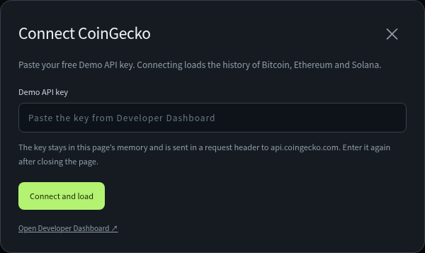
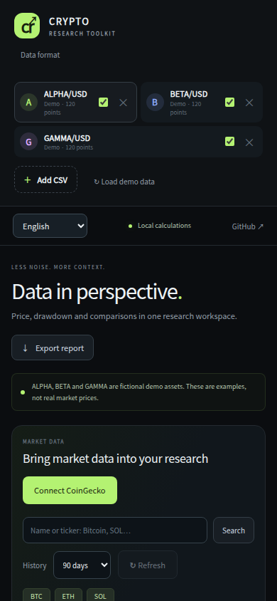

# Crypto Research Toolkit

A browser dashboard for comparing crypto price histories, inspecting drawdowns
and saving a research report. Load CoinGecko data with your Demo API key, or work
locally with CSV files. A Python CLI is included for decimal calculations.

[**User guide**](docs/USER_GUIDE.md) · [**Quick start**](#quick-start) · [**Development & CLI**](#development-and-checks)


*English interface. ALPHA, BETA and GAMMA are fictional demo assets, not real market prices.*

## Quick start

1. Choose **Code → Download ZIP** on GitHub and extract the archive.
2. Open **`dist/crypto-research-toolkit.html`** in your browser. No installation or build is needed.
3. Select **English** in the language menu at the top right.
4. Click **Connect CoinGecko**, paste your Demo API key, then choose **Connect and load**. Bitcoin, Ethereum and Solana load in USD.
5. Check the assets to compare, choose **Compare · 100**, and select a chart period.
6. Use **Export report** to save the result.

**No key yet?** Click **Load demo data** to explore, or **Add CSV** to analyze your own history.

The standalone HTML contains the whole dashboard. Download and open it locally;
viewing its source on GitHub does not run the app. You can also open `index.html`
from an extracted repository with the `assets` folder beside it.

## What you can do

| Task | Controls |
| --- | --- |
| Compare relative price changes | Check assets → **Compare · 100**. |
| Inspect one asset’s price | Select an asset → **Price**. |
| Fetch a longer history | Choose 7, 30, 90 or 365 days under **History**. |
| Filter observations already loaded | Use **7D / 30D / 90D / All loaded**. |
| Request updated online data | Click **Refresh**. |
| Analyze your own observations | **Add CSV**, or drag and drop a file. |
| Save research | **Export report** → Markdown, JSON, CSV or SVG. |

**All loaded is not lifetime history.** If you loaded only 90 days, it can look
the same as **90D**. For a longer lookback, choose **365 days** under **History**.
Comparisons use only the overlapping period of the checked assets.

Read the [step-by-step user guide](docs/USER_GUIDE.md) for connection setup,
metric explanations, CSV examples, mobile use and troubleshooting.

## Setup and mobile preview

<table>
<tr>
<td align="center"></td>
<td align="center"></td>
</tr>
<tr><td align="center">Connect your own Demo API key</td><td align="center">Responsive mobile layout</td></tr>
</table>

Screenshots use fictional demo data. No API key appears in these images.

## CoinGecko and privacy

- Get a Demo API key from the [CoinGecko Developer Dashboard](https://www.coingecko.com/en/developers/dashboard).
- The key is sent directly to `api.coingecko.com` in the `x-cg-demo-api-key` header and retained only in the open page’s memory. It is not saved in the source, browser storage or reports.
- Closing/reloading the page clears the data and key. **Disconnect and clear key** clears the connection while retaining loaded observations.
- Fetching happens on connect and user actions; there is no background polling. Repeated loads can use a five-minute cache. **Refresh** makes new requests and preserves your chart filter; provider delays and quotas still apply.
- **Cancel loading** aborts the request and clears the key. Already received observations are retained. Reconnect before requesting again.
- Errors and partial refreshes are reported. Failed series keep their previous data; real histories are never silently replaced with demo prices.
- CSV contents remain local. The only saved browser preference is the language code.

Search covers CoinGecko-listed coins, not arbitrary onchain contracts or DEX pools.
API access depends on your provider plan and network. If browser access is
blocked by network or CORS restrictions, CSV and demo mode remain available.

API references: [history](https://docs.coingecko.com/demo/reference/coins-id-market-chart),
[coin search](https://docs.coingecko.com/demo/reference/search-data),
[errors/rate limits](https://docs.coingecko.com/docs/errors-and-rate-limits).
Market data attribution: [CoinGecko](https://www.coingecko.com/en/api).

## Six interface languages

**English · 한국어 · 日本語 · Deutsch · Русский · Español**

Use the menu at the top right. The initial language follows a supported browser
preference, with English as the fallback. An explicit choice is remembered when
storage is available. Switching keeps loaded data, selection, chart period and
connection without making API calls.

UI labels, messages, accessibility labels, chart tooltips and human-readable
reports follow the selected language. Dates and regular decimal formatting use
that locale; observation times remain UTC. JSON/CSV field names, numeric data,
tickers, CoinGecko IDs and ISO timestamps stay stable. The Python CLI is separate.

Translations are bundled in `assets/i18n.js`: no translation service, CDN or
external font download is needed. The app uses installed system fonts.

## Methodology and limitations

Comparison uses the **intersection of selected time ranges**. Each series needs
at least two observations inside that window. Insufficient overlap is shown
explicitly. Each series' first recorded price in the window becomes 100; those
first observation timestamps need not be identical. Tooltips identify the actual
nearest observation time for each series. Missing records are not resampled or
invented. Lines connect recorded points as a visual guide.

Drawdown resets at the beginning of the selected period. The quality panel
checks that period, while its last-observation date uses the entire dataset.
An interval over 1.5 times the median is a **heuristic**, not proof of a missing
record. Even uniform intervals do not establish authenticity or completeness.

CSV export is a combined five-column analysis table
(`timestamp,symbol,series,price,synthetic`), not the three-column import format.
Filter one series and retain `timestamp,symbol,price` to import it again.
JSON/Markdown include source filenames and input SHA-256 hashes when Web Crypto
is available. Demo series have no original-file hash.

The dashboard uses JavaScript floating-point numbers; use the Python CLI for
decimal arithmetic. Browser timestamps must use ISO 8601 with a timezone and at
most three fractional-second digits. Limits: 5 MiB and 100,000 observations per
file, up to eight series. Large charts preserve bucket extrema while reducing
rendered points; statistics use all observations.

## Development and checks

Plain HTML/CSS/JavaScript, without frontend dependencies. From the repo root:

```sh
python tools/build_standalone.py
node --test tests/analytics.test.cjs tests/coingecko.test.cjs tests/i18n.test.cjs
python -m unittest discover -s tests -v
```

The six-language suite additionally checks live switching, localized messages,
number/date formatting, stable export contracts, language-only persistence and
24 language/viewport combinations (320, 390, 768 and 1400 px). API fixtures are
explicitly synthetic.

The first command regenerates `dist/crypto-research-toolkit.html` from source.
Commit source and bundle together. Node 18+ is needed only for developer tests.

Optional browser checks require Playwright with Chromium installed:

```sh
npm install --no-save playwright
npx playwright install chromium
node tests/dashboard-browser.cjs
node tests/coingecko-browser.cjs
node tests/audit-browser.cjs
node tests/i18n-browser.cjs
```

The offline browser suite checks CSV import, invalid data, periods, chart controls,
exports, mobile and standalone operation without external network requests.
The behavioral audit additionally checks every period button, fresh refreshes,
all exports, mobile/tablet dialogs, capacity, cancellation, concurrent-import
guards and standalone file operation. See [audit findings](docs/audit-2026-10-20.md).
The CoinGecko browser suite intercepts requests with explicitly synthetic test
fixtures to check key isolation, cache, search, provenance, API errors and disconnect.
Regression screenshots use temporary paths so they do not overwrite the published
English documentation images.

To regenerate all six English documentation screenshots with fictional demo data
and an empty key field, run:

```sh
node tools/capture_docs.cjs
```

This writes the images in `docs/` without making external API requests.

An optional real-data smoke test is available as `tests/coingecko-live.cjs`.
It reads `COINGECKO_DEMO_API_KEY` from the process environment without printing it.
For restricted test environments, `COINGECKO_TEST_HTTPS_TRANSPORT=python` delegates
HTTPS in the test harness to Python's certificate-validating urllib; the app
itself still calls CoinGecko directly. This test-only mode is not a production proxy.


## Python CLI

Python 3.10 or newer. Run from the repository root:

```sh
python crypto_report.py examples/sample_prices.csv
python crypto_report.py examples/sample_prices.csv --format json
python -m unittest discover -s tests -v
```

On Windows, `py` may be used instead of `python`.

The example starts at 100 and ends at 105: change is **5%**. Its largest observed
decline is from 120 to 80: maximum sampled drawdown is **33.333333%**.
See the generated [example report](examples/sample_report.md).

## Input contract

UTF-8 CSV (an optional BOM is accepted) with exactly these column names:

```csv
timestamp,symbol,price
2026-01-01T00:00:00Z,SAMPLE/USD,100
2026-01-02T04:00:00+04:00,SAMPLE/USD,105
```

- One asset/quote pair per file, using the same case-sensitive symbol throughout.
- At least two observations. Rows are sorted by time before calculation.
- ISO 8601 timestamps must include a timezone; offsets are normalized to UTC.
- Duplicate instants are rejected, including duplicates expressed in different timezones.
- Prices must be positive, finite decimals between `1e-30` and `1e30`, with at most 40 coefficient digits.
- Symbols may contain letters, numbers, `.`, `_`, `/`, and `-`, up to 48 characters.
- Missing/extra columns, mixed pairs and malformed data fail with exit code 2.

The tool writes only to standard output. To save a report:

```sh
python crypto_report.py examples/sample_prices.csv > report.md
```

Do not redirect output to the input CSV. Prices and percentages are strings in
JSON, preserving decimal values; percentages are rounded to six decimal places.

## What the numbers mean

| Metric | Calculation |
| --- | --- |
| Change | `(last - first) / first * 100` |
| Maximum sampled drawdown | Largest `(earlier running peak - later price) / peak * 100`, reported as a positive decline |
| Sample minimum / maximum | Lowest / highest observed value in the file |
| Input SHA-256 | Hash of the original bytes, including row order and line endings |

These are **sample statistics**, not exchange OHLC values. Irregular sampling,
missing observations, stale data and price manipulation can change the result.
The CLI has no annualization, live price fetching, portfolio accounting or profitability
forecast. Fees, slippage, liquidity and token contract risks are not evaluated.

## Research checklist

Before interpreting a real file, record its source, retrieval time, asset contract
and chain, quote currency, sampling interval and any gaps. A matching ticker is
not proof that two sources describe the same asset.

## Contributing

Bug reports should include a minimal **synthetic** CSV, the command, expected
result and Python version. Please do not submit API keys, private trading history
or wallet credentials. Run the test command above before proposing code changes.

## License

[MIT](LICENSE).
