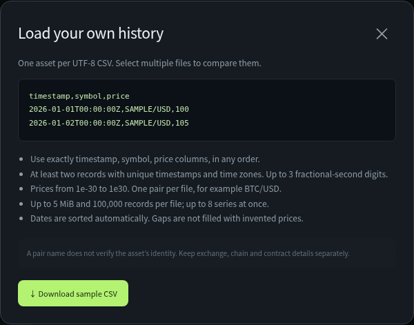
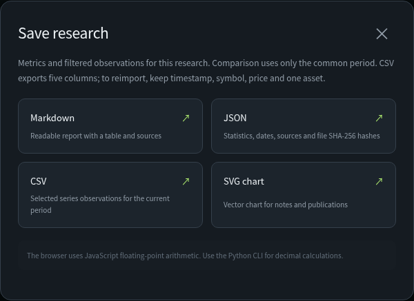
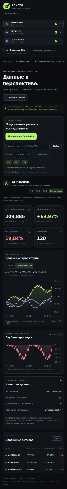

# Crypto Research Toolkit — User Guide

Compare crypto price histories, inspect drawdowns and save a research report.
You can use CoinGecko, import your own CSV files or explore the built-in demo.
No wallet connection or software installation is needed for the dashboard.

[Get started](#get-started) · [Connect CoinGecko](#connect-coingecko) · [Compare assets](#compare-assets) · [Import CSV](#import-your-own-csv) · [Export](#save-your-research) · [Troubleshooting](#troubleshooting)


*Screenshots use the fictional ALPHA, BETA and GAMMA demo series. They are not real market prices. The connection screenshot has an empty key field.*

## Get started

1. Open the [GitHub repository](https://github.com/crypota/crypto-research-toolkit).
2. Select **Code → Download ZIP**, then extract the ZIP.
3. Open **`dist/crypto-research-toolkit.html`** in Chrome, Edge, Firefox or another modern browser. Double-click the file, or use **Open with** and choose your browser.
4. Choose **English** in the language menu at the top right. The first language follows your browser preference.
5. Choose a data source:

| What you want to do | Start here |
| --- | --- |
| Try the app without a key | Click **Load demo data**. |
| Research real market history | Click **Connect CoinGecko**. |
| Analyze a file you already have | Click **Add CSV**, or drop the file into the upload area. |

The standalone HTML file contains the entire dashboard. You can move it to another folder without the rest of the repository. Opening the HTML source on GitHub does not run the application: download and open the file locally.

## Connect CoinGecko

1. Get your Demo API key from the [CoinGecko Developer Dashboard](https://www.coingecko.com/en/developers/dashboard).
2. In the app, click **Connect CoinGecko**.
3. Paste your key into **Demo API key**.
4. Click **Connect and load**. The app loads Bitcoin, Ethereum and Solana in USD.
5. To add another coin, enter its name or ticker, click **Search**, check the **CoinGecko ID**, then click **Add**.


The key is sent directly to CoinGecko and kept only in the open page’s memory. It is not included in reports or saved in the HTML. After closing or reloading the page, enter the key again.

### Fetch more history or refresh prices

| Control | What it does |
| --- | --- |
| **History: 7 / 30 / 90 / 365 days** | Requests that lookback for the selected online assets. A successful load resets the chart filter to all loaded history. |
| **Refresh** | Makes new requests for the selected online assets, bypassing the app’s cache. It preserves the current chart filter. Provider delays and rate limits still apply. |
| **BTC / ETH / SOL** | Adds the coin or reloads its existing series. Repeated loads can use the five-minute cache. |
| **Cancel loading** | Stops the request and clears the key. Already received observations remain available. Reconnect before making another API request. |

There is no background polling. The app fetches data when you connect or use a loading control. Each online asset shows its requested history length and fetch time.

## Compare assets

1. Click an asset in the sidebar to make it active. Its metrics and drawdown are shown.
2. Check the assets you want to compare.
3. Choose **Compare · 100** to start each series at 100 within their common period.
4. Use **7D**, **30D**, **90D** or **All loaded** to filter the observations already in memory.
5. Read the available date range below the active asset. Move the pointer over a chart to inspect observations. You can also focus a chart and use the arrow keys, **Home**, **End** and **Escape**.

**All loaded means all the history currently loaded for the selected comparison.** It does not request the coin’s entire lifetime history. If you loaded 90 days, **90D** and **All loaded** can look the same. To get a longer lookback, select **365 days** under **History** first.

Comparisons use the overlap between selected histories. A recently launched coin or a short CSV can shorten that common period. Choose **Price** to inspect only the active asset in its original quote units.

### Read the metrics

| Metric | Meaning |
| --- | --- |
| **End-of-period price** | Last observation inside the selected analysis period; this is not necessarily the current trading price. |
| **Period change** | Percentage change from the first to the last observation in that period. |
| **Max drawdown** | Largest observed fall from a preceding running peak. The peak calculation starts again at the selected period’s beginning. |
| **Observations** | Number of recorded prices used in the calculation. |
| **Data quality** | Sampling intervals, unusually long gaps and excluded API rows. It does not verify token safety or the authenticity of a CSV. |

Example: compare BTC, ETH and SOL over a shared 90-day window, inspect which had the largest sampled drawdown, then save the comparison as a Markdown report.

## Import your own CSV

Click **Data format → Download sample CSV** to get a working example. Replace the sample with your own observations, then choose **Add CSV**.

```csv
timestamp,symbol,price
2026-01-01T00:00:00Z,BTC/USD,100
2026-01-02T00:00:00Z,BTC/USD,120
2026-01-03T00:00:00Z,BTC/USD,90
```

*These example prices illustrate the format only; they are not actual Bitcoin prices.*



- Use a UTF-8 file with exactly **timestamp**, **symbol** and **price** columns.
- Put one asset/quote pair in each file and include at least two observations.
- Include the time zone in every timestamp; duplicate instants are rejected.
- Use a decimal point in CSV prices, regardless of the interface language.
- You can load up to eight series. Each file can contain up to 100,000 observations and must be no larger than 5 MiB.

Rows are sorted automatically. Missing observations are not invented. Your files stay local to the browser.

## Save your research

Click **Export report** and choose a format:

| Format | Best for |
| --- | --- |
| **Markdown** | A readable research note with a comparison table and sources. |
| **JSON** | Structured metrics, timestamps and provenance for other tools. |
| **CSV** | The selected series’ observations within the current analysis window. |
| **SVG chart** | A vector chart for notes and publications. |



Reports follow the current mode and analysis period. Markdown and JSON include source information; online histories also include retrieval time. The API key is never exported.

CSV export has five columns: `timestamp,symbol,series,price,synthetic`. To import it back into the app, keep just one asset and the three input columns: `timestamp,symbol,price`.

Save your report before closing or reloading the page. Loaded data is kept in memory, not restored automatically.

## Language and mobile use

Choose **English**, **한국어**, **日本語**, **Deutsch**, **Русский** or **Español** at the top right. Switching languages keeps your datasets, selection, chart period and connection. Only your language preference is remembered between visits when browser storage is available.

The mobile layout has the same main controls. Swipe horizontally inside the comparison table to see its remaining columns.



## Troubleshooting

| What you see | What to do |
| --- | --- |
| No **Connect CoinGecko** button | Open the current standalone file. An older downloaded file does not update itself when GitHub changes. |
| **All loaded** looks the same as **90D** | You may have loaded only 90 days. Choose **365 days** under **History** for a longer lookback. |
| No common period | Uncheck histories that do not overlap, load a compatible range, or choose **Price** for one asset. |
| Key rejected | Check that you copied the complete Demo API key, then reconnect. |
| Rate-limit message | Wait before retrying. Previously loaded data stays available. |
| Connection or CORS error | Check internet access to CoinGecko. CSV import and the demo remain usable. |
| Only some histories updated | Read the error messages and each asset’s lookback/fetch time. Failed series retain their previous observations. |
| Refresh produces the same chart | A new request can still return unchanged or delayed provider data. Check the fetch time. |
| Data disappeared after reload | This is expected. Reconnect, reload your CSV, or use a previously exported report. |

The toolkit is useful for price-history research. It does not provide trading signals, return forecasts, portfolio accounting or token safety scores.

[Back to the repository overview](../README.md)
